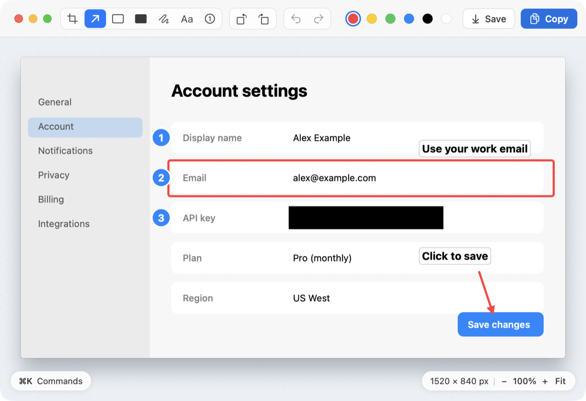
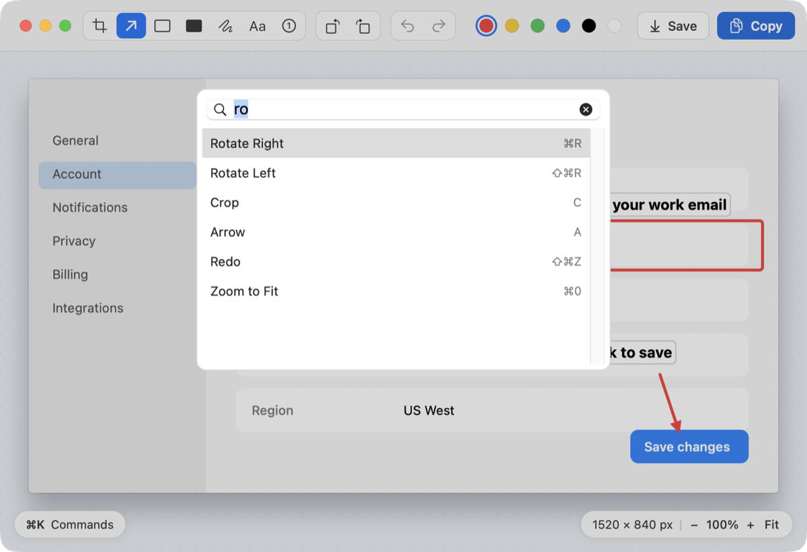
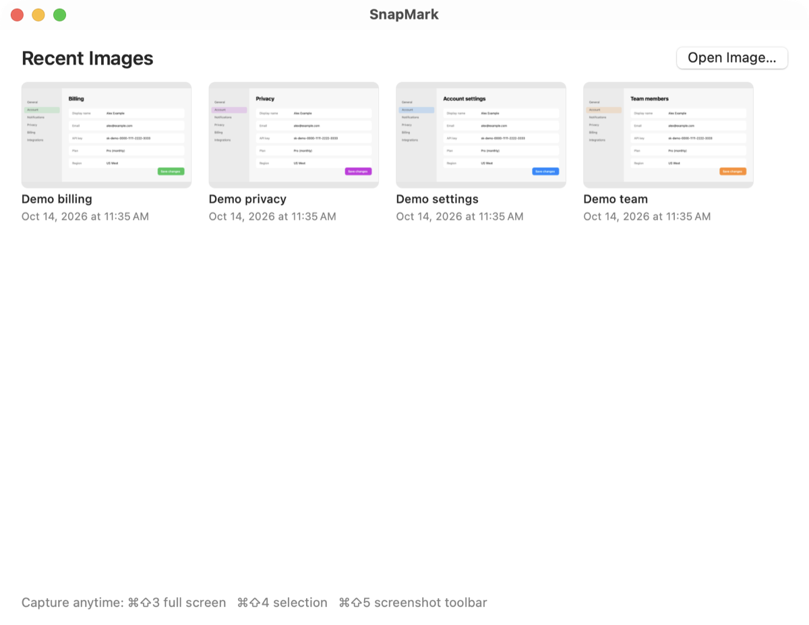

<p align="center"></p>

<h1 align="center">SnapMark</h1>

SnapMark is a small macOS menu bar app. It takes a screenshot with the default macOS keys and opens the screenshot in an editor. In the editor, you can crop and mark up the screenshot with the keyboard and the mouse.



## Screenshots

| Command palette (⌘K) | Start window |
| --- | --- |
|  |  |

Requirement: macOS 13 (Ventura) or later, and the Xcode Command Line Tools (`xcode-select --install`).

## 1. Build and install

```bash
cd screenshot-app
./build.sh install
```

This builds `build/SnapMark.app`, copies it to `/Applications`, and starts it. A camera icon shows in the menu bar.

## 2. Free the default screenshot keys

macOS uses ⌘⇧3, ⌘⇧4 and ⌘⇧5 for its own screenshot tool. You must turn these off, or macOS gets the keys before SnapMark.

1. Open **System Settings > Keyboard**.
2. Click **Keyboard Shortcuts…**.
3. Select **Screenshots**.
4. Clear these check boxes:
   - Save picture of screen as a file (⌘⇧3)
   - Save picture of selected area as a file (⌘⇧4)
   - Screenshot and recording options (⌘⇧5)
5. Click **Done**.
6. Quit and open SnapMark again, so that it can register the keys.

The SnapMark menu also has **Open Keyboard Shortcuts Settings…**.

## 3. Give the Screen Recording permission

At first start, SnapMark asks for Screen Recording permission. Without this permission, screenshots show only the desktop background, not the windows.

1. Open **System Settings > Privacy & Security > Screen & System Audio Recording**.
2. Turn on **SnapMark**.
3. Quit and open SnapMark again.

SnapMark does **not** need the Accessibility permission. It uses the Carbon hotkey API, which works without it.

Note: `build.sh` signs the app with an ad-hoc signature. Each new build has a new signature, so macOS can ask for Screen Recording permission again after a rebuild. To prevent this, sign with your own identity: `SIGN_ID="Apple Development: Your Name (TEAMID)" ./build.sh install`. Run `security find-identity -v -p codesigning` to list your identities; if two have the same name, pass the 40-character hash instead. Without `SIGN_ID`, the build stays ad-hoc.

## Keys

| Key | Action |
| --- | --- |
| ⌘⇧3 | Capture the main display |
| ⌘⇧4 | Select an area (press Space to select a window, Esc to cancel) |
| ⌘⇧5 | Show the macOS screenshot toolbar |

In the editor, the top bar has the tools (as icons), rotate, undo/redo, colors, **Save** and **Copy**. The bottom-left pill opens the command palette (⌘K); the bottom-right pill shows the image size in pixels and the zoom (−, +, Fit).

| Key | Action |
| --- | --- |
| — | Pick a color with the swatches in the toolbar. |
| C | Crop tool. Drag an area; the crop applies when you release the mouse. |
| A | Arrow |
| R | Rectangle |
| B | Blackout. Drag a solid black box over anything confidential. The saved PNG and the copy have those pixels replaced with black. |
| P | Pen |
| S | Step: click to place a numbered circle (1, 2, 3… in order; renumbers after undo) |
| T | Text caption (black on white by default; the swatches set the text color separately from shapes). Click, type, then press Return (Esc cancels). Click existing text (or double-click it with any tool) to edit it; clear it to delete. |
| ⌘Z | Undo (also undoes a crop or rotate) |
| ⇧⌘Z | Redo (also toolbar buttons) |
| ⌘C | Copy to the clipboard |
| ⌘S | Save (overwrites the Desktop file) |
| ⌘R / ⌘⇧R | Rotate 90° right / left (also toolbar buttons) |
| Pinch | Zoom in around the pointer (up to 8×) |
| Two-finger scroll | Pan while zoomed in |
| ⌘0 | Zoom to fit |
| ⌘+ / ⌘− | Zoom in / out |
| ⌘K | Command palette: type to search any command (tools, colors, rotate, zoom, save…), Up/Down, Return to run, Esc to close |
| ⌘W | Close without save |

Each capture is saved to the Desktop right away, with the macOS name, for example `Screenshot 2026-10-14 at 12.47.19 PM.png`. A preview then shows in the bottom-left corner of the screen for 3 seconds (hover to keep it). Click the preview to open the editor. In the editor, ⌘S overwrites that same Desktop file.

When you open SnapMark from Finder, Spotlight or the Dock (or open it again while it runs), a start window shows up to 12 recent images and an **Open Image…** button. It does not show at login. The menu bar menu has **Show Start Window**.

To edit an existing image, use **Open Image…** in the menu bar menu, choose **Open With > SnapMark** in Finder, or drop the image on the SnapMark app icon. Saving overwrites that file.

The menu bar menu also has **Launch at Login**.

## Files

| File | Purpose |
| --- | --- |
| `Sources/SnapMark/main.swift` | Starts the app as a menu bar app |
| `AppDelegate.swift` | Menu, hotkeys, permission request |
| `HotKeyManager.swift` | Global hotkeys (Carbon `RegisterEventHotKey`) |
| `Capture.swift` | Runs `/usr/sbin/screencapture` |
| `ThumbnailPanel.swift` | Bottom-left preview after a capture |
| `EditorWindowController.swift` | Editor window, copy and save |
| `CanvasView.swift` | Crop, markup, undo, keys |
| `Annotation.swift` | Markup shapes and the final image render |
| `scripts/make-icon.swift` | Draws the app icon into `Resources/AppIcon.icns` |

## Known limits

- ⌘⇧3 captures only the main display.
- ⌘⇧⌃ (Control) variants are not registered.
- You cannot move or edit markup after you draw it. Use undo.
